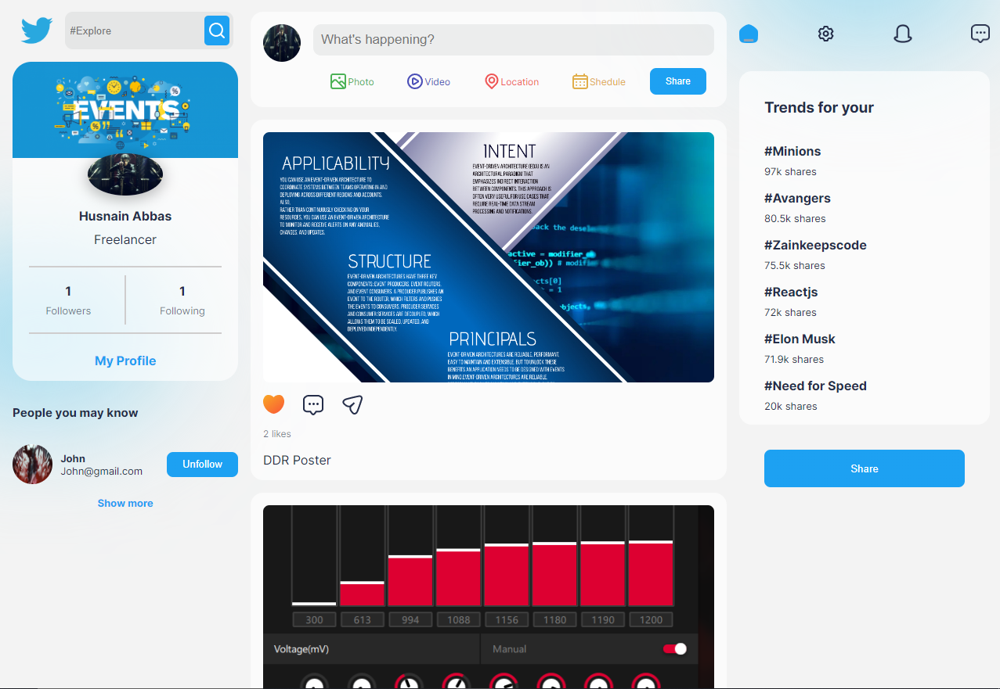
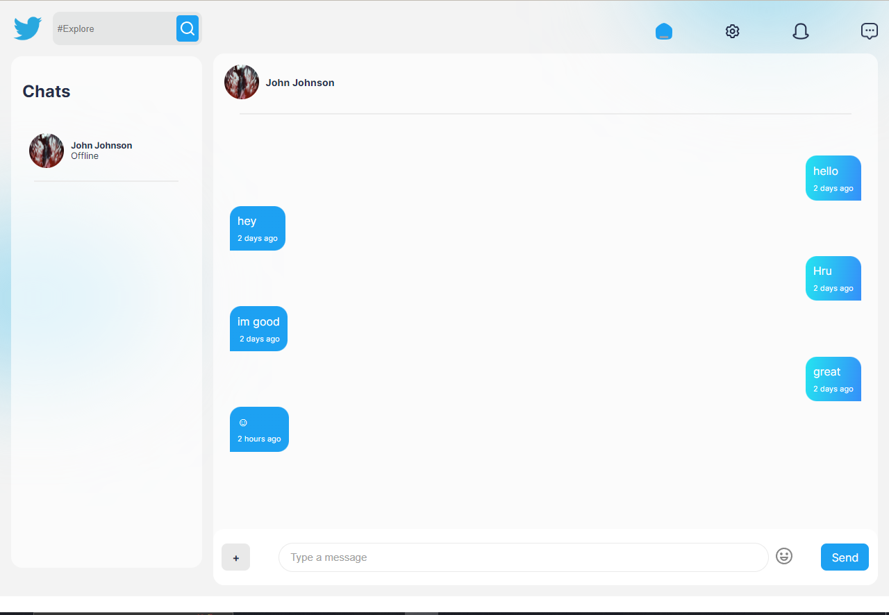

# SocialMediaApp

A full-stack social media and real-time chat application built with the **MERN stack** (MongoDB, Express, React, Node.js) and **Socket.io**.




---

## Features

- **Authentication** – Register and log in with JWT-based authentication and bcrypt password hashing
- **User Profiles** – View and edit profile information, follow/unfollow other users
- **Posts** – Create, view, and like posts with image uploads
- **Real-time Chat** – One-to-one messaging with live delivery powered by Socket.io
- **Online Presence** – See which users are currently online
- **Responsive UI** – Built with Mantine UI and custom CSS

---

## Tech Stack

| Layer    | Technology |
|----------|-----------|
| Frontend | React 17, Redux, React Router v6, Mantine UI, Socket.io-client, Axios |
| Backend  | Node.js, Express, Mongoose, Multer, JWT, bcrypt |
| Database | MongoDB |
| Realtime | Socket.io |

---

## Project Structure

```
SocialMediaApp/
├── Client/          # React frontend
│   └── src/
│       ├── pages/   # Auth, Home, Profile, Chat
│       ├── components/
│       ├── actions/ # Redux actions
│       ├── reducers/
│       └── api/     # Axios API calls
├── Server/          # Express REST API
│   ├── routes/      # Auth, User, Post, Upload, Chat, Message
│   ├── models/      # Mongoose schemas
│   ├── middleware/  # Auth middleware
│   └── index.js
└── Socket/          # Socket.io server (port 8800)
    └── index.js
```

---

## Getting Started

### Prerequisites

- Node.js ≥ 16
- MongoDB instance (local or Atlas)
- npm or yarn

### 1. Clone the repository

```bash
git clone https://github.com/Husnain192/SocialMediaApp.git
cd SocialMediaApp
```

### 2. Set up the Server

```bash
cd Server
npm install
```

Create a `.env` file in the `Server` directory:

```env
MONGO_DB=<your_mongodb_connection_string>
JWT_KEY=<your_jwt_secret>
PORT=5000
```

Start the server:

```bash
npm start
```

### 3. Set up the Socket server

```bash
cd Socket
npm install
npm start
```

The Socket.io server runs on **port 8800**.

### 4. Set up the Client

```bash
cd Client
npm install
npm start
```

The React app runs on **port 3000** and proxies API requests to `http://localhost:5000`.

---

## API Routes

| Method | Endpoint          | Description              |
|--------|-------------------|--------------------------|
| POST   | `/auth/register`  | Register a new user      |
| POST   | `/auth/login`     | Log in                   |
| GET    | `/user/:id`       | Get user profile         |
| PUT    | `/user/:id`       | Update user profile      |
| PUT    | `/user/:id/follow`| Follow a user            |
| GET    | `/posts/:id`      | Get a post               |
| POST   | `/posts`          | Create a post            |
| PUT    | `/posts/:id/like` | Like/unlike a post       |
| GET    | `/chat/:userId`   | Get chats for a user     |
| POST   | `/chat`           | Create/access a chat     |
| GET    | `/message/:chatId`| Get messages in a chat   |
| POST   | `/message`        | Send a message           |

---

## Deployment

The backend is configured for deployment on **Vercel** (`vercel.json` included in `Server/`). The frontend can be deployed to any static hosting platform (Vercel, Netlify, etc.).

---

## License

This project is open source and available under the [ISC License](https://opensource.org/licenses/ISC).

